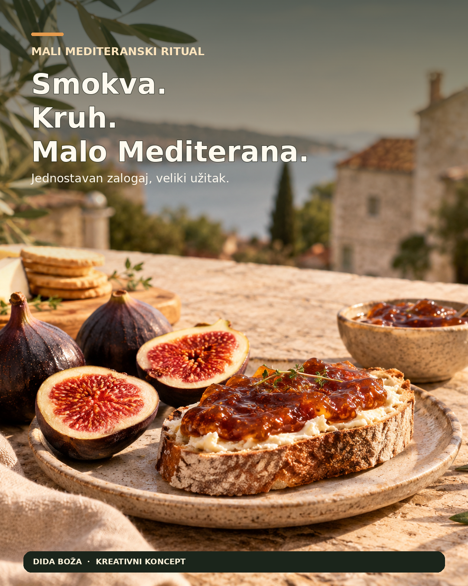

# 🍯 AI Recept: Dida Boža — Generator Instagram Sadržaja


Ovaj repozitorij sadrži izvršivi AI recept — **interaktivnu Streamlit aplikaciju** (`app.py`) i pripadajuću Python skriptu (`generate_content.py`) — korišten za izradu tri gotove Instagram objave za hrvatski brend **Dida Boža**. Projekt demonstrira kako se korištenjem AI alata može ubrzati proces stvaranja sadržaja uz zadržavanje autentičnog vizualnog identiteta brenda.

> **Što je stvarno isporučeno:** Tri statične Instagram objave (slike s tekstom) + PDF dokumentacija + Python recept + promptovi + **interaktivna Streamlit aplikacija**.
> **Što recept može generirati (ali nije isporučeno u ovoj predaji):** promptove i tekstove za Karusel i Reel. Odabir formata je slobodan prema zadatku, a fokus je stavljen na visoko kvalitetne statične objave.

## 📋 Brifing i ulazne reference

**Brend:** Dida Boža (@dida_boza) — hrvatski proizvođač ekoloških džemova i namaza.
**Proizvod u fokusu:** Ekološki džem od smokve (240 g).

**Izvori korišteni za analizu:**
*   Službena stranica: [didaboza.hr](https://www.didaboza.hr/)
*   Stranica proizvoda: [Ekološki džem od smokve](https://www.didaboza.hr/hr/proizvodi/ekoloski-dzemovi/ekoloski-dzem-smokva/)
*   Instagram profil: [@dida_boza](https://www.instagram.com/dida_boza/)
*   Vizualne reference: tople zemljane boje, kamen, maslinove grančice, rustikalna keramika, prirodno svjetlo "zlatnog sata".

**Provjereni podaci (sa službene stranice):** proizvod je ekološki certificiran (BIO), sadrži smokvu iz ekološkog uzgoja, preporučuje se uz tost, bruskete i krekere.
**Pretpostavke (na temelju vizualnog identiteta):** ciljna publika su ljubitelji prirodnih proizvoda, foodie scena i ljudi koji cijene "Slow Living"; ton komunikacije je topao, nostalgičan i edukativan.

## 📦 Isporučeni materijali (Deliverables)
*   🌐 [Interaktivna aplikacija](./app.py) - Streamlit sučelje za generiranje objava.
*   📄 [Osvrt i upute (PDF)](./Osvrt_i_Upute.pdf) - Dokumentacija, analiza i osvrt.
*   📝 [Tekstovi objava (TXT)](./Tekstovi_objava.txt) - Konačni copy za sve tri objave.
*   ⚙️ [Recept i promptovi (TXT)](./Recept_i_Promptovi.txt) - Paket promptova za ručno korištenje.
*   🐍 [Python skripta](./generate_content.py) - Automatizirani generator sadržaja (CLI).
*   🧪 [Primjer izlaza (TXT)](./primjer_izlaza_dry_run.txt) - Dokaz uspješnog testiranja skripte (`--dry-run`).

## 🎨 Vizualni rezultati (Tri gotove objave)

*Slike su generirane pomoću opisanih AI promptova, a zatim finalizirane u Canvi (dodavanje tipografije i integracija proizvoda).*

| Objava 1 | Objava 2 (s proizvodom) | Objava 3 |
| :---: | :---: | :---: |
|  |  |  |
| *Cilj: Poticanje interakcije* | *Cilj: Prikaz proizvoda i edukacija* | *Cilj: Emocionalna povezanost* |

### 🛠️ Konkretan primjer ljudske dorade (prije → poslije)

**Prije (AI generirano):** Prompt je generirao mediteransku terasu s tanjurom, sirom i džemom, ali **bez stvarne staklenke Dida Boža** — AI bi izmislio etiketu, što je neprihvatljivo za brend.
**Nakon (ljudska dorada u Canvi):**
1. S web stranice brenda preuzeta je stvarna fotografija staklenke.
2. Pozadina je uklonjena (Canva "Background Remover").
3. Staklenka je pozicionirana u prvi plan generirane scene.
4. Dodana je meka sjena kako bi se stopila s izvorom svjetla.
5. Dodana je tipografija ("Slatko susreće slano" itd.) i brending banner.
**Rezultat:** vidi `images/staklenka.jpg` — stvarni proizvod u AI-generiranom ambijentu, bez izmišljanja etikete.

---

## 📝 Konačni tekstovi objava (Copy)

**Objava 1 (Slatko susreće slano)**
> Slatko susreće slano. 🧀🍯
> Jeste li ikada probali smokvu uz sir? Ta mala promjena donosi potpuno novo iskustvo za stolom. Dida Boža džem od smokve savršeno se slaže s kremastim sirom na kriški domaćeg kruha. 
> Ako ste ljubitelj ovakvih kombinacija, napišite nam u komentarima - koji je vaš omiljeni sir uz smokvu? 👇
> #DidaBoza #Smokva #SlatkoSlano #Dalmacija #Gourmet #FoodieCroatia

**Objava 2 (Smokva. Kruh. Malo Mediterana.)**
> Mali mediteranski ritual. 🌿🌊
> Smokva. Kruh. Malo Mediterana. Ponekad je za savršen užitak potrebno samo nekoliko pravih sastojaka i trenutak vremena za sebe. 
> Spremite ovu objavu za svoj sljedeći brunch i uživajte u okusu Dalmacije. 📌
> #DidaBoza #MediteranskiUgođaj #Brunch #SlowLiving #EkoDzem #HrvatskaHrana

**Objava 3 (Mali ritual. Veliki užitak.)**
> Okus koji usporava dan. ⏳✨
> Mali ritual. Veliki užitak. Pronađite svoj omiljeni način posluživanja našeg ekološkog džema od smokve. Bilo da ga mažete na tost, dodajete u jogurt ili poslužujete uz sir – svaki zalogaj je podsjetnik na sunce i more.
> Označite osobu s kojom biste podijelili ovaj trenutak. 👇
> #DidaBoza #Smokva #Tradicija #Uživanje #BreakfastIdeas #CroatianFood

---

## 🌐 Kako pokrenuti interaktivnu aplikaciju (Streamlit) — preporučeno

Preferirani način za ponavljanje recepta je kroz web-sučelje.

### 1. Instalacija
```bash
git clone https://github.com/1244Matt1244/dida-boza-ai-recept.git
cd dida-boza-ai-recept
pip install -r requirements.txt
