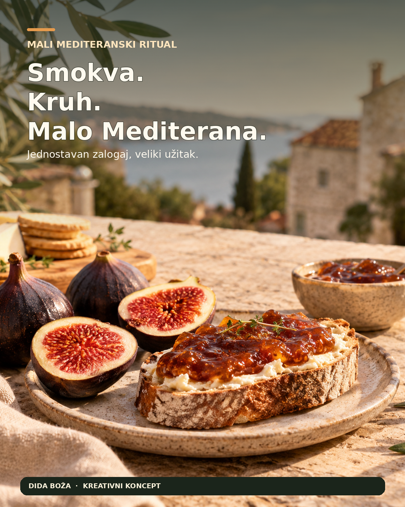

# 🍯 AI Recept: Dida Boža — Generator Instagram Sadržaja


Ovaj repozitorij sadrži izvršivi AI recept (Python skriptu) korišten za izradu tri gotove Instagram objave za hrvatski brend **Dida Boža**. 

Cilj projekta je demonstrirati kako se korištenjem AI alata (LLM i generativna slika) može ubrzati i unaprijediti proces stvaranja sadržaja za društvene mreže, uz zadržavanje autentičnog vizualnog identiteta brenda.

## 🎨 Vizualni rezultati (Finalne objave)

*Ove slike su generirane pomoću opisanih promptova, a zatim finalizirane u Canvi (integracija stvarnog proizvoda i tipografija).*

| Objava 1 | Objava 2 | Objava 3 |
| :---: | :---: | :---: |
|  |  |  |
| *Cilj: Poticanje interakcije* | *Cilj: Edukacija i spremanje* | *Cilj: Emocionalna povezanost* |

### 🔍 Dokaz ljudske dorade (Integracija stvarnog brenda)
Kako bi se izbjeglo da AI "izmisli" etiketu, korištena je stvarna staklenka Dida Boža s njihove službene stranice, koja je naknadno ubačena u AI-generirani ambijent:


---

## 🚀 Kako pokrenuti

### 1. Preduvjeti
Potreban vam je [Python 3.8+](https://www.python.org/downloads/) i aktivan [OpenAI API ključ](https://platform.openai.com/).

### 2. Instalacija
Klonirajte repozitorij i instalirajte potrebne ovisnosti:
```bash
git clone https://github.com/1244Matt1244/dida-boza-ai-recept.git
cd dida-boza-ai-recept
pip install -r requirements.txt
