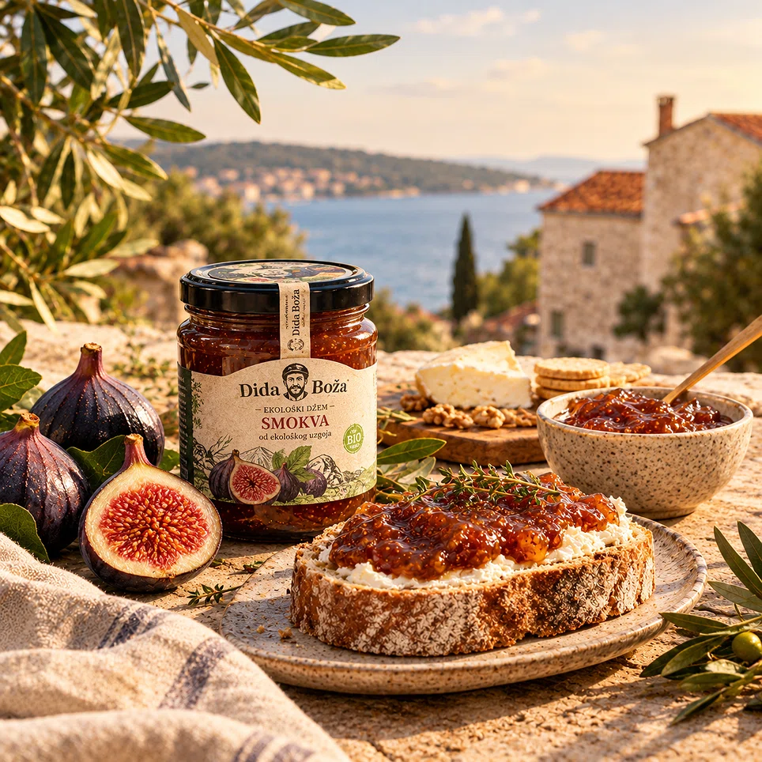
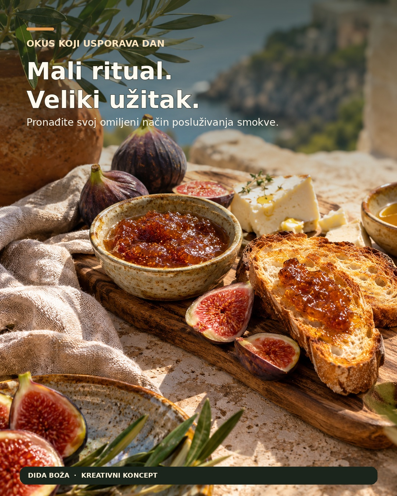

# 🍯 AI Recept: Dida Boža — Generator Instagram Sadržaja


[](https://dida-boza-ai-recept-hcp9mzhdpg2sauln56z57m.streamlit.app/)


Ovaj repozitorij sadrži izvršivi AI recept — **interaktivnu Streamlit aplikaciju** (`app.py`) i pripadajuću Python skriptu (`generate_content.py`) — korišten za izradu tri gotove Instagram objave za hrvatski brend **Dida Boža**. Projekt demonstrira kako se korištenjem AI alata može ubrzati proces stvaranja sadržaja uz zadržavanje autentičnog vizualnog identiteta brenda.

## 🚀 Live demo

Aplikacija je dostupna na Streamlitu — **bez instalacije i bez API ključa** (dry-run je uključen prema zadanim postavkama):

**👉 [dida-boza-ai-recept.streamlit.app](https://dida-boza-ai-recept-hcp9mzhdpg2sauln56z57m.streamlit.app/)**

Za stvarno generiranje teksta i vizuala (DALL-E 3), vidi sekciju „Kako pokrenuti interaktivnu aplikaciju" ispod.

---

> **Što je stvarno isporučeno:** Tri statične Instagram objave (slike s tekstom) + PDF dokumentacija + Python recept + promptovi + **interaktivna Streamlit aplikacija** s opcionalnom DALL-E 3 integracijom.
> **Što recept može generirati:** tekstove i hashtagove (GPT-4o), vizualne promptove, te opcionalno same slike (DALL-E 3) i karusel od 4 slajda. U ovoj predaji fokus je stavljen na tri statične objave, dok su karusel i DALL-E generiranje dostupni u aplikaciji.

## 📋 Brifing i ulazne reference

**Brend:** Dida Boža (@dida_boza) — hrvatski proizvođač ekoloških džemova i namaza.
**Proizvod u fokusu:** Ekološki džem od smokve (240 g).

**Izvori korišteni za analizu:**
*   Službena stranica: [didaboza.hr](https://www.didaboza.hr/)
*   Stranica proizvoda: [Ekološki džem od smokve](https://www.didaboza.hr/hr/proizvodi/ekoloski-dzemovi/ekoloski-dzem-smokva/)
*   Instagram profil: [@dida_boza](https://www.instagram.com/dida_boza/)
*   Vizualne reference: tople zemljane boje, kamen, maslinove grančice, rustikalna keramika, prirodno svjetlo "zlatnog sata".

**Provjereni podaci (sa službene stranice):** proizvod je ekološki certificiran (BIO), sadrži smokvu iz ekološkog uzgoja, preporučuje se uz tost, bruskete i krekere.
**Pretpostavke (na temelju vizualnog identiteta):** ciljna publika su ljubitelji prirodnih proizvoda, foodie scena i ljudi koji cijene "Slow Living"; ton komunikacije je topao, nostalgičan i edukativan.

## 📦 Isporučeni materijali (Deliverables)
*   🌐 [Interaktivna aplikacija](./app.py) - Streamlit sučelje s interaktivnim brifingom.
*   🚀 [Live demo](https://dida-boza-ai-recept-hcp9mzhdpg2sauln56z57m.streamlit.app/) - Aplikacija hostana na Streamlit Cloudu.
*   📄 [Osvrt i upute (PDF)](./Osvrt_i_Upute.pdf) - Dokumentacija, analiza i osvrt.
*   📝 [Tekstovi objava (TXT)](./Tekstovi_objava.txt) - Konačni copy za sve tri objave.
*   ⚙️ [Recept i promptovi (TXT)](./Recept_i_Promptovi.txt) - Paket promptova po fazama (Ulaz → Proces → Izlaz).
*   🐍 [Python skripta](./generate_content.py) - Automatizirani generator sadržaja (CLI + DALL-E 3 funkcije).
*   🧪 [Primjer izlaza (TXT)](./primjer_izlaza_dry_run.txt) - Dokaz uspješnog testiranja skripte (`--dry-run`).

## 🎨 Vizualni rezultati (Tri gotove objave)

*Slike su generirane pomoću opisanih AI promptova, a zatim finalizirane u Canvi (dodavanje tipografije i integracija proizvoda).*

| Objava 1 | Objava 2 (s proizvodom) | Objava 3 |
| :---: | :---: | :---: |
|  |  |  |
| *Cilj: Poticanje interakcije* | *Cilj: Prikaz proizvoda i edukacija* | *Cilj: Emocionalna povezanost* |

### 🛠️ Konkretan primjer ljudske dorade (prije → poslije)

**Prije (AI generirano):** Prompt je generirao mediteransku terasu s tanjurom, sirom i džemom, ali **bez stvarne staklenke Dida Boža** — AI bi izmislio etiketu, što je neprihvatljivo za brend.
**Nakon (ljudska dorada u Canvi):**
1. S web stranice brenda preuzeta je stvarna fotografija staklenke.
2. Pozadina je uklonjena (Canva "Background Remover").
3. Staklenka je pozicionirana u prvi plan generirane scene.
4. Dodana je meka sjena kako bi se stopila s izvorom svjetla.
5. Dodana je tipografija ("Slatko susreće slano" itd.) i brending banner.
**Rezultat:** vidi `images/staklenka.jpg` — stvarni proizvod u AI-generiranom ambijentu, bez izmišljanja etikete.

---

## 📝 Konačni tekstovi objava (Copy)

**Objava 1 (Slatko susreće slano)**
> Slatko susreće slano. 🧀🍯
> Jeste li ikada probali smokvu uz sir? Ta mala promjena donosi potpuno novo iskustvo za stolom. Dida Boža džem od smokve savršeno se slaže s kremastim sirom na kriški domaćeg kruha.
> Ako ste ljubitelj ovakvih kombinacija, napišite nam u komentarima - koji je vaš omiljeni sir uz smokvu? 👇
> #DidaBoza #Smokva #SlatkoSlano #Dalmacija #Gourmet #FoodieCroatia

**Objava 2 (Smokva. Kruh. Malo Mediterana.)**
> Mali mediteranski ritual. 🌿🌊
> Smokva. Kruh. Malo Mediterana. Ponekad je za savršen užitak potrebno samo nekoliko pravih sastojaka i trenutak vremena za sebe.
> Spremite ovu objavu za svoj sljedeći brunch i uživajte u okusu Dalmacije. 📌
> #DidaBoza #MediteranskiUgođaj #Brunch #SlowLiving #EkoDzem #HrvatskaHrana

**Objava 3 (Mali ritual. Veliki užitak.)**
> Okus koji usporava dan. ⏳✨
> Mali ritual. Veliki užitak. Pronađite svoj omiljeni način posluživanja našeg ekološkog džema od smokve. Bilo da ga mažete na tost, dodajete u jogurt ili poslužujete uz sir – svaki zalogaj je podsjetnik na sunce i more.
> Označite osobu s kojom biste podijelili ovaj trenutak. 👇
> #DidaBoza #Smokva #Tradicija #Uživanje #BreakfastIdeas #CroatianFood

---

## 🌐 Kako pokrenuti interaktivnu aplikaciju (Streamlit) — preporučeno

Preferirani način za ponavljanje recepta je kroz web-sučelje.

### Brzi put: live demo

Otvori **[dida-boza-ai-recept.streamlit.app](https://dida-boza-ai-recept-hcp9mzhdpg2sauln56z57m.streamlit.app/)** — dry-run je uključen prema zadanim postavkama, pa je demonstracija moguća bez API ključa.

### Lokalno pokretanje

#### 1. Instalacija
```bash
git clone https://github.com/1244Matt1244/dida-boza-ai-recept.git
cd dida-boza-ai-recept
pip install -r requirements.txt
```

#### 2. Konfiguracija (opcionalno)
Za stvarno generiranje potreban je OpenAI API ključ:
```bash
cp config.example.env .env
# uredite .env i upišite OPENAI_API_KEY
```
Ako preskočite ovaj korak, aplikacija radi u **dry-run** načinu (prikazuje primjer izlaza bez poziva API-ja).

#### 3. Pokretanje
```bash
streamlit run app.py
```
Aplikacija se otvara na `http://localhost:8501`.

#### 4. Što aplikacija nudi
- **Interaktivni brifing** u bočnoj traci: proizvod, ciljna publika, cilj objava, ton komunikacije
- **Dodatne reference** (opcionalno): web stranica brenda i inspiracija
- **Dry-run** (bez API ključa) za demonstraciju
- **Stvarno generiranje teksta** putem GPT-4o (temperatura 0.7)
- **DALL-E 3 generiranje vizuala** (opcionalno uz API ključ):
  - **Statična slika** — jedna AI-generirana scena
  - **Karusel (4 slajda)** — četiri povezane scene za višeslajdnu objavu
- Prikaz tri generirane objave s prijelomima redova
- Gumb za **preuzimanje rezultata u .txt**

> ⚠️ **Napomena o DALL-E 3:** Generiranje slika troši OpenAI kredit (~$0.04 po slici). Ako nema API ključa, DALL-E opcija je automatski skrivena u sidebaru — aplikacija i dalje radi u dry-runu.

#### 5. Odnos prema CLI skripti
`app.py` uvozi `generate_with_api`, `get_mock_content`, `generate_image` i `generate_carousel_images` iz `generate_content.py`, pa je logika generiranja **na jednom mjestu**. Izmjena prompta ili modela u `generate_content.py` automatski se odražava i u aplikaciji i u CLI-ju.

---

## 🚀 Kako pokrenuti Python skriptu (CLI)

### 1. Preduvjeti
Potreban vam je [Python 3.8+](https://www.python.org/downloads/) i aktivan [OpenAI API ključ](https://platform.openai.com/).

### 2. Instalacija
```bash
git clone https://github.com/1244Matt1244/dida-boza-ai-recept.git
cd dida-boza-ai-recept
pip install -r requirements.txt
```

### 3. Konfiguracija (.env)
Kopirajte primjer konfiguracijske datoteke i dodajte svoj API ključ:
```bash
cp config.example.env .env
```
Zatim otvorite `.env` i zamijenite vrijednost: `OPENAI_API_KEY=sk-proj-vas_tajni_kljuc_ovdje`.
*(Napomena: `.env` je zaštićena `.gitignore` pravilima).*

### 4. Pokretanje
**Opcija A — s API ključem (stvarno generiranje):**
```bash
python generate_content.py
```
**Opcija B — bez API ključa (dry-run za testiranje):**
```bash
python generate_content.py --dry-run
```

## ⚙️ Što skripta radi?
Skripta koristi OpenAI API (model **GPT-4o**) kako bi generirala specifične vizualne promptove, tekstove i hashtagove za sve tri forme (Karusel, Slika, Reel). Rezultat se **automatski sprema** u mapu `output/`. Dokaz uspješnog testiranja dostupan je u datoteci `primjer_izlaza_dry_run.txt`.

Uz `generate_with_api`, skripta sadrži i dvije pomoćne funkcije:
- **`generate_image(client, prompt)`** — generira jednu sliku pomoću DALL-E 3
- **`generate_carousel_images(client, base_prompt, num_slides=4)`** — generira 4 varijacije iste teme za karusel

---

## 📈 Plan mjerenja i unapređenja (Feedback Loop)

**Što mjerimo nakon objave:**
| Metrika | Kako se mjeri | Cilj |
|---------|---------------|------|
| Spremljene objave (saves) | Instagram Insights | > 50 po objavi |
| Komentari | Instagram Insights | > 20 po objavi |
| Doseg (reach) | Instagram Insights | > 5.000 organskih |
| Stopa interakcije | (lajkovi + komentari + spremanja) / doseg | > 5% |

**Kako se recept poboljšava na temelju podataka:**
1. **Tjedan 1:** Objave se objavljuju, prikupljaju se podaci 7 dana.
2. **Tjedan 2:** Analiza — ako Objava 1 (interakcija) ima najviše komentara, sljedeći ciklus fokusira se na pitanja publici. Ako Objava 2 (edukacija) ima najviše spremanja, sljedeći ciklus ide u smjeru recepata i kulinarskih savjeta.
3. **Tjedan 3:** AI prompt se ažurira s novim smjernicama na temelju podataka.
4. **Tjedan 4:** A/B test dviju varijanti na manjem dijelu publike.

## 📁 Struktura repozitorija
```text
├── app.py                   # Streamlit aplikacija (preporučeni ulaz)
├── generate_content.py      # Glavna skripta (CLI + DALL-E 3 funkcije)
├── requirements.txt         # Python ovisnosti
├── config.example.env       # Primjer konfiguracije bez ključa
├── .streamlit/
│   └── config.toml          # Tema i postavke za Streamlit Cloud
├── .gitignore               # Ignorira .env i output/
├── README.md                # Dokumentacija
├── Osvrt_i_Upute.pdf        # Završni PDF dokument
├── Tekstovi_objava.txt      # Konačni tekstovi
├── Recept_i_Promptovi.txt   # Paket promptova
├── primjer_izlaza_dry_run.txt # Dokaz testiranja
└── images/                  # Finalni vizuali
```

---

## ☁️ Deploy na Streamlit Cloud

Aplikacija je hostana na besplatnom Streamlit Community Cloudu. Za ponovni deploy ili vlastitu instancu:

1. Prijavi se na [share.streamlit.io](https://share.streamlit.io) GitHub računom.
2. **Create app** → odaberi repo `1244Matt1244/dida-boza-ai-recept`, branch `main`, main file `app.py`.
3. (Opcionalno) U **Advanced settings → Secrets** zalijepi `OPENAI_API_KEY = "sk-..."` za stvarno generiranje teksta i vizuala.
4. **Deploy**.

Napomena: besplatni plan uspava aplikaciju nakon 7 dana neaktivnosti — prvo otvaranje traje 10–30 sekundi. Ako API ključ nije postavljen u Secrets, DALL-E opcija je automatski skrivena, a dry-run radi bez ograničenja.

---

## 🎯 Sažetak tehničkih odluka

| Odluka | Obrazloženje |
|---|---|
| Streamlit (umjesto React/Next.js) | Brz razvoj, Python-native, besplatan hosting |
| GPT-4o za tekst | Najbolji omjer kvalitete i cijene za copy na hrvatskom |
| DALL-E 3 za vizuale | Integriran s OpenAI API-jem, kvalitetne editorial fotografije |
| Dry-run kao default | Demonstracija bez trošenja kredita i bez API ključa |
| Skrivanje DALL-E bez ključa | Sprječava greške kod korisnika bez ključa |
| Interaktivni brifing u sidebaru | Personalizacija bez mijenjanja koda |
| Zajednička logika u `generate_content.py` | Jedan izvor istine za app i CLI |