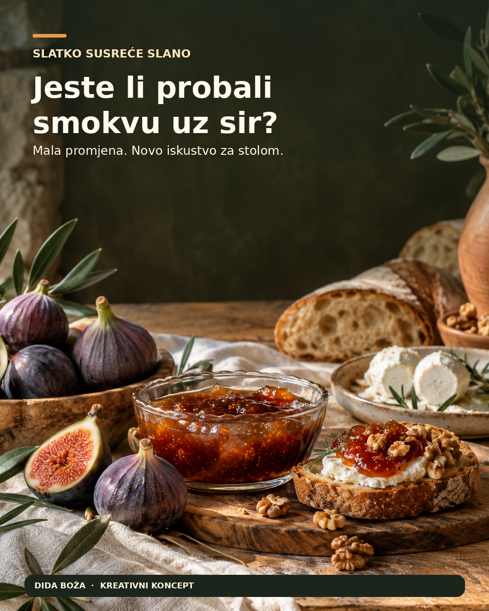
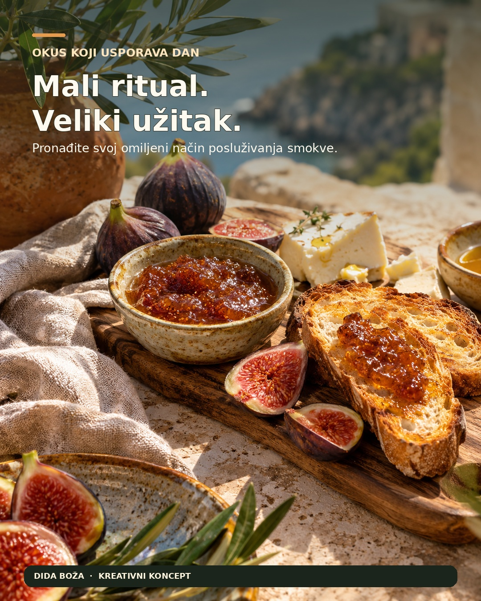
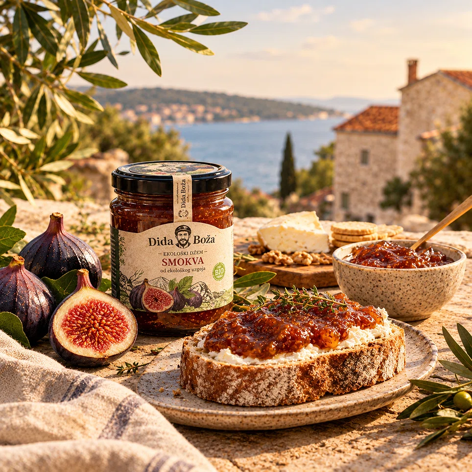

# 🍯 AI Recept: Dida Boža — Generator Instagram Sadržaja


Ovaj repozitorij sadrži izvršivi AI recept (Python skriptu) korišten za izradu tri gotove Instagram objave za hrvatski brend **Dida Boža**. 

Cilj projekta je demonstrirati kako se korištenjem AI alata (LLM i generativna slika) može ubrzati i unaprijediti proces stvaranja sadržaja za društvene mreže, uz zadržavanje autentičnog vizualnog identiteta brenda.

## 🎨 Vizualni rezultati (Finalne objave)

*Ove slike su generirane pomoću opisanih promptova, a zatim finalizirane u Canvi (integracija stvarnog proizvoda i tipografija).*

| Objava 1 | Objava 2 | Objava 3 |
| :---: | :---: | :---: |
|  |  |  |
| *Cilj: Poticanje interakcije* | *Cilj: Edukacija i spremanje* | *Cilj: Emocionalna povezanost* |

### 🔍 Dokaz ljudske dorade (Integracija stvarnog brenda)
Kako bi se izbjeglo da AI "izmisli" etiketu, korištena je stvarna staklenka Dida Boža s njihove službene stranice, koja je naknadno ubačena u AI-generirani ambijent:



---

## 🚀 Kako pokrenuti

### 1. Preduvjeti
Potreban vam je [Python 3.8+](https://www.python.org/downloads/) i aktivan [OpenAI API ključ](https://platform.openai.com/).

### 2. Instalacija
Klonirajte repozitorij i instalirajte potrebne ovisnosti:
```bash
git clone https://github.com/1244Matt1244/dida-boza-ai-recept.git
cd dida-boza-ai-recept
pip install -r requirements.txt
```

### 3. Konfiguracija (.env)
Kopirajte primjer konfiguracijske datoteke i dodajte svoj API ključ:
```bash
cp config.example.env .env
```
Zatim otvorite `.env` datoteku i zamijenite vrijednost:
```text
OPENAI_API_KEY=sk-proj-vas_tajni_kljuc_ovdje
```
*(Napomena: `.env` datoteka je zaštićena `.gitignore` pravilima i nikada se neće poslati na GitHub).*

### 4. Pokretanje
```bash
python generate_content.py
```

---

## ⚙️ Što skripta radi?
Skripta koristi OpenAI API (model **GPT-4o**) kako bi generirala:
1. **Specifične vizualne promptove** za svaku od 3 objave (Karusel, Pojedinačna slika, Reel).
2. **Copy (tekstove)** i hashtagove prilagođene hrvatskom tržištu.
3. **Upute za ljudsku doradu** (kako spojiti AI pozadinu sa stvarnim proizvodom u Canvi).
4. Automatski sprema rezultate u `output/generirani_sadrzaj.txt`.

*Napomena: Skripta ne generira same slike kako bi se izbjeglo trošenje API kredita, već vraća točne promptove i tekstove koje možete zalijepiti u ChatGPT ili DALL-E.*

---

## 📁 Struktura repozitorija
```text
├── generate_content.py      # Glavna skripta (Recept)
├── requirements.txt         # Python ovisnosti
├── config.example.env       # Primjer konfiguracije bez ključa
├── .gitignore               # Ignorira .env i cache
├── README.md                # Dokumentacija
├── Osvrt_i_Upute.pdf        # Završni PDF dokument s osvrtom
├── Tekstovi_objava.txt      # Konačni tekstovi za sve tri objave
├── Recept_i_Promptovi.txt   # Paket promptova za ručno korištenje
└── images/                  # Finalni vizuali (dokaz rada)
```

## ⚠️ Ograničenja
AI generirane slike ne mogu se koristiti kao vjerodostojan prikaz stvarnog pakiranja bez intervencije čovjeka. Za najbolje rezultate, obavezna je integracija stvarnog proizvoda (ljudska dorada). Također, AI video alati još uvijek imaju problema s konzistentnošću tekstura hrane u pokretu, stoga je fokus stavljen na statične objave.

## 📄 Licenca
Ovaj projekt je otvorenog koda i dostupan pod [MIT licencom](https://choosealicense.com/licenses/mit/).
